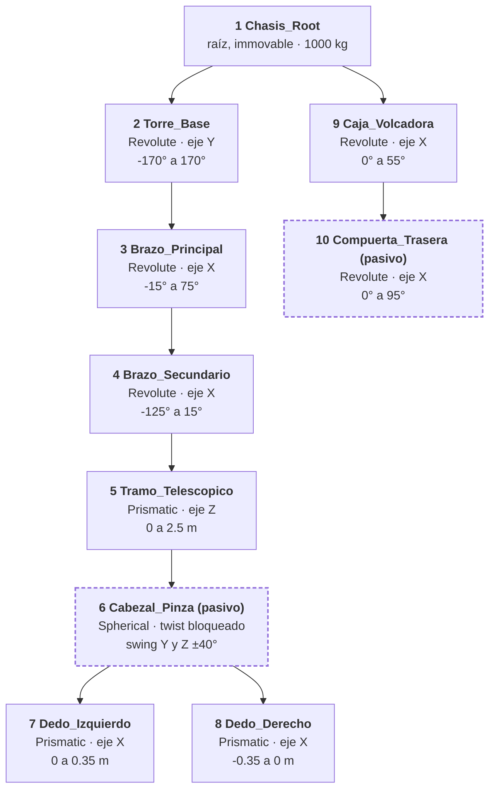

# Diagrama y explicación

Simulador de camión volcador con hidrogrúa · Unity 6000.3.14f1 · `ArticulationBody`.

## 1. Qué máquina y qué operación

Un **camión volcador con hidrogrúa** (grúa articulada con pinza montada detrás de la cabina). La operación tiene dos fases:

- **Carga:** la grúa toma cubos de 8 kg del suelo con una pinza de dos dedos (agarre por fricción, sin atar el cubo al cabezal) y los deposita en la caja.
- **Descarga:** se repliega la grúa, se eleva la caja volcadora hasta 55° y las cargas, al resbalar, abren por contacto la compuerta trasera pasiva y caen al corralón. Al bajar la caja la compuerta vuelve a cerrarse sola.

Todo el mecanismo es un único árbol de 10 cuerpos con raíz `Chasis_Root` (inmóvil). Ejes del mundo: X derecha, Y arriba, Z adelante (cabina en +Z).

## 2. Árbol de articulaciones

Imagen sin Mermaid: [`diagrama_articulaciones.svg`](diagrama_articulaciones.svg). Los ejes y límites son los de `TruckSpec`; los ángulos están en grados y los desplazamientos en metros, relativos al padre.

Resumen de la consigna: 10 cuerpos, 3 tipos de joint (Revolute, Prismatic, Spherical), 7 drives (torre, pluma, secundario, telescópico, dos dedos, caja) controlados por 6 comandos (los dos dedos comparten comando) y 2 pasivos (cabezal y compuerta).

Notas de orientación: el movimiento de cada joint ocurre sobre el eje X de su ancla, que el generador rota para que coincida con el eje declarado. La caja se construye girada 180° sobre Y, de modo que un ángulo positivo levanta el frente; la compuerta cuelga de su borde superior y un ángulo positivo la abre hacia atrás. El dedo derecho usa el mismo eje X con el rango negativo y recibe el target opuesto al izquierdo.

## 3. Masas y drives

Valores de `TruckSpec`. *Stiffness* de los drives angulares por radián; amortiguamiento en N·m·s/rad (angulares) o N·s/m (lineales).

| Cuerpo | Masa kg | Stiffness | Damping | Force limit |
|---|---|---|---|---|
| Chasis_Root | 1000 | n/a | n/a | n/a |
| Torre_Base | 150 | 60 000 | 6 000 | 120 000 |
| Brazo_Principal | 100 | 90 000 | 9 000 | 180 000 |
| Brazo_Secundario | 60 | 65 000 | 6 500 | 110 000 |
| Tramo_Telescopico | 35 | 45 000 | 4 500 | 60 000 |
| Cabezal_Pinza (pasivo) | 15 | 0 | 25 | ilimitado |
| Dedo_Izquierdo | 5 | 25 000 | 2 500 | **300** |
| Dedo_Derecho | 5 | 25 000 | 2 500 | **300** |
| Caja_Volcadora | 250 | 120 000 | 12 000 | 250 000 |
| Compuerta_Trasera (pasivo) | 20 | 0 | 10 | ilimitado |

Las masas bajan de la raíz a la punta (1000, 150, 100, 60, 35, 15, 5): una cadena con masas parecidas o con un eslabón liviano al final de uno pesado oscila y es difícil de resolver para el solver, sobre todo en WebGL. Solver: 16 iteraciones de posición y 4 de velocidad; `Fixed Timestep` 0.02 s.

**Desvío respecto de la tabla inicial: `forceLimit` de los dedos = 300 N (la tabla del diseño decía 20 000 N).** Con target 0.35 m contra un cubo de 0.5 m, cada dedo queda 0.2 m corto del target; con 25 000 N/m eso pide 5000 N de apriete por dedo, y el límite de 20 000 N no lo recortaba. El resultado era interferencia física de 82 mm entre dedos y cubo. Se midió el hueco entre dedos con el cubo agarrado y elevado, bajando el límite: sin interferencia desde 500 N; se eligió 300 N, que queda 2.3 veces por debajo del primer valor con interferencia visible (700 N). El agarre sigue sobrado: el cubo pesa 78 N y la fricción de los dos dedos a 300 N da unos 486 N (6 veces). Las mediciones están en `CALIBRACION.md`, sección 8.2.

**Pasivos.** `Cabezal_Pinza` tiene stiffness 0: ningún drive lo mantiene, cuelga por gravedad con la garra debajo del ancla y solo el amortiguamiento (25) evita que oscile como péndulo. Su cono de swing es de ±40° y está centrado cuando el telescópico apunta 30° bajo la horizontal; queda vertical dentro de 1° en las poses de trabajo. `Compuerta_Trasera` tiene stiffness 0: con la caja baja la gravedad la mantiene cerrada (límite inferior 0°) y al inclinar la abren la gravedad y el empuje de las cargas, con amortiguamiento 10 para que no golpee. Un `forceLimit` de 0 en la tabla significa "pasivo", no "sin fuerza": el generador usa un límite ilimitado para no anular el amortiguamiento.

## 4. Cómo se controla

Control híbrido de teclado y sliders sobre los mismos 6 ejes (tabla de teclas en el [`README.md`](../README.md)):

- Cada eje guarda un **Target**. El teclado lo mueve a velocidad constante (`Target = Clamp(Target + eje · velocidad · Δt)`; por ejemplo 45 °/s la torre, 0.8 m/s el telescópico) y los sliders lo escriben al arrastrarlos. Teclas opuestas apretadas a la vez se cancelan.
- En `FixedUpdate` cada eje copia el Target a `drive.target`. La pinza aplica `+t` al dedo izquierdo y `-t` al derecho. Nada mueve un `ArticulationBody` con `transform`.
- La **telemetría** del panel muestra por eje `Target` (lo pedido) y `Real` (la posición medida de la articulación, convertida de radianes a grados). La diferencia es el hundimiento por peso y el retardo del drive, y se ve en vivo, por ejemplo `Pluma principal | Target: 30.0° | Real: 28.7°`.
- Los sliders tienen navegación desactivada para no consumir las flechas; la cámara orbita con botón derecho y se acerca con la rueda; `Retroceso`, `P` o el botón recargan la escena.

## 5. Cómo se eligieron los valores de los drives

Se partió de una tabla inicial (stiffness, damping y force limit crecientes hacia la raíz) y se verificó cada joint con tres estimaciones, de la raíz a la punta, en el peor caso (pluma y secundario horizontales, telescópico extendido 2.5 m):

1. **Torque estático** `τ = Σ m·g·brazo`, que debe caber bien dentro del `forceLimit`.
2. **Hundimiento** `τ / stiffness`, que debe ser chico (la tolerancia de los tests es de 6° angular y 0.08 m lineal).
3. **Razón de amortiguamiento** `ζ = damping / (2·√(stiffness·I))`, con `I = Σ m·r²` de lo que cuelga del joint, para que el movimiento asiente sin oscilar de forma sostenida.

| Joint | Torque estático | Hundimiento peor caso | ζ estimado |
|---|---|---|---|
| Torre | sin carga estática (la gravedad es perpendicular al eje) | n/a | 0.19 |
| Pluma | 8000 N·m (4% del `forceLimit`) | 5.1° | 0.23 |
| Secundario | 3000 N·m | 2.7° | 0.37 |
| Telescópico | 590 N (1% del `forceLimit`) | 0.013 m | 1.4 |
| Caja | 4900 N·m | 2.4° | 0.51 |
| Dedos | sin carga estática | n/a | 3.5 |

El torque estático consume entre 1% y 4% del `forceLimit`, así que el límite nunca satura con carga normal. Con los valores de la tabla los seis ejes llegaron a su target sin cambios, salvo los dedos (sección 3): por ejemplo, con los ejes al 50% del rango el error medido fue de 1.3° en la pluma, 1.7° en el secundario, 0.01 m en el telescópico y 1.5° en la caja. La torre, con la menor razón de amortiguamiento, rebasa unos 0.8° al girar 90° y asienta en menos de 2 s. Los ejes de la grúa y la caja quedaron subamortiguados (ζ de 0.2 a 0.5) pero ninguno oscila de forma sostenida; el telescópico y los dedos están sobreamortiguados (ζ de 1.4 y 3.5).

## 6. Materiales de fricción

| Material | Fricción dinámica / estática | Combine | Uso |
|---|---|---|---|
| `Mat_GomaPinza` | 0.9 / 0.95 | Multiply | dedos y cubos |
| `Mat_AceroCaja` | 0.25 / 0.3 | Average | piso de la caja |
| `Mat_Suelo` | 0.1 / 0.1 | Average | suelo |

- **Multiply y no Maximum para la goma.** Con *Maximum* (el modo de mayor prioridad) la goma gana contra cualquier superficie y el acero del piso de la caja no interviene: los cubos no resbalaban antes de unos 40°. Con *Multiply* la fricción dedo-cubo es 0.81 (suficiente para agarrar) y cubo-acero 0.23 dinámica y 0.29 estática (el producto de 0.9 por 0.25 y de 0.95 por 0.3), y los cubos resbalan a unos 27.5°, cerca de los 25° buscados.
- **`Mat_Suelo`.** A 20 °/s las cargas deslizaban a unos 30° a 36°, chocaban con la compuerta y caían al pie de la caja en dos capas, dejando la compuerta apoyada en la pila. Con un suelo de fricción baja (0.1, que contra la goma da 0.09) las cargas que caen se deslizan y despejan la zona, y la compuerta vuelve a cerrar (menos de 5°) al bajar la caja. El agarre no cambia porque depende de la fricción dedo-cubo.

La calibración completa, con las mediciones, está en [`CALIBRACION.md`](CALIBRACION.md).
