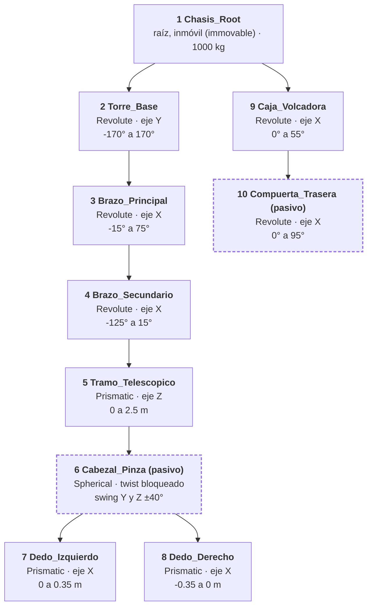

# Diagrama y explicación

Simulador de camión volcador con hidrogrúa · Unity 6000.3.14f1 · `ArticulationBody`.

## 1. Qué máquina y qué operación

Un **camión volcador con hidrogrúa** (grúa articulada con pinza montada detrás de la cabina). La operación tiene dos fases:

- **Carga:** la grúa toma cubos de 8 kg del suelo con una pinza de dos dedos (agarre por fricción, sin atar el cubo al cabezal) y los deposita en la caja.
- **Descarga:** se repliega la grúa, se eleva la caja volcadora hasta 55° y las cargas, al resbalar, abren por contacto la compuerta trasera pasiva y caen al corralón. Al bajar la caja la compuerta vuelve a cerrarse sola.

Todo el mecanismo es un único árbol de 10 cuerpos con raíz `Chasis_Root` (inmóvil). Ejes del mundo: X derecha, Y arriba, Z adelante (cabina en +Z).

## 2. Árbol de articulaciones

Imagen sin Mermaid: [`diagrama_articulaciones.svg`](diagrama_articulaciones.svg). Los ejes y límites son los de `TruckSpec`; los ángulos están en grados y los desplazamientos en metros, relativos al padre.

Resumen de la consigna: 10 cuerpos, 3 tipos de joint (Revolute, Prismatic, Spherical), 7 drives (torre, pluma, secundario, telescópico, dos dedos, caja) controlados por 6 comandos (los dos dedos comparten comando) y 2 pasivos (cabezal y compuerta).

Notas de orientación: el movimiento de cada joint ocurre sobre el eje X de su ancla, que el generador rota para que coincida con el eje declarado. La caja se construye girada 180° sobre Y, de modo que un ángulo positivo levanta el frente; la compuerta cuelga de su borde superior y un ángulo positivo la abre hacia atrás. El dedo derecho usa el mismo eje X con el rango negativo y recibe el target opuesto al izquierdo.

## 3. Masas y drives

Valores de `TruckSpec`. *Stiffness* de los drives angulares por radián; amortiguamiento en N·m·s/rad (angulares) o N·s/m (lineales).

| Cuerpo | Masa kg | Stiffness | Damping | Force limit |
|---|---|---|---|---|
| Chasis_Root | 1000 | n/a | n/a | n/a |
| Torre_Base | 150 | 60 000 | 6 000 | 120 000 |
| Brazo_Principal | 100 | 90 000 | 9 000 | 180 000 |
| Brazo_Secundario | 60 | 65 000 | 6 500 | 110 000 |
| Tramo_Telescopico | 35 | 45 000 | 4 500 | 60 000 |
| Cabezal_Pinza (pasivo) | 15 | 0 | 25 | ilimitado |
| Dedo_Izquierdo | 5 | 25 000 | 2 500 | **300** |
| Dedo_Derecho | 5 | 25 000 | 2 500 | **300** |
| Caja_Volcadora | 250 | 120 000 | 12 000 | 250 000 |
| Compuerta_Trasera (pasivo) | 20 | 0 | 10 | ilimitado |

Las masas bajan de la raíz a la punta (1000, 150, 100, 60, 35, 15, 5): una cadena con masas parecidas o con un eslabón liviano al final de uno pesado oscila y es difícil de resolver para el solver, sobre todo en WebGL. Solver: 16 iteraciones de posición y 4 de velocidad; `Fixed Timestep` 0.02 s.

**Desvío respecto de la tabla inicial: `forceLimit` de los dedos = 300 N (el diseño decía 20 000 N).** Con target 0.35 m contra un cubo de 0.5 m, el drive pediría 5000 N por dedo y el cubo quedaba aplastado 82 mm; midiendo el hueco con el cubo agarrado y elevado, no hay interferencia desde 500 N. Se eligió 300 N (el cubo pesa 78 N y la fricción de los dos dedos da unos 486 N). Detalle en `CALIBRACION.md`, sección 8.2.

**Pasivos.** Con stiffness 0 no hay drive: el cabezal cuelga por gravedad (swing ±40°, amortiguamiento 25 contra el péndulo) y la compuerta se mantiene cerrada por gravedad con la caja baja y la abren el peso y el empuje de las cargas al volcar. Un `forceLimit` de 0 significa "pasivo", no "sin fuerza": el generador usa un límite ilimitado para no anular el amortiguamiento.

## 4. Cómo se controla

Control híbrido de teclado y sliders sobre los mismos 6 ejes (tabla de teclas en el [`README.md`](../README.md)):

- Cada eje guarda un **Target**. El teclado lo mueve a velocidad constante (`Target = Clamp(Target + eje · velocidad · Δt)`; por ejemplo 45 °/s la torre, 0.8 m/s el telescópico) y los sliders lo escriben al arrastrarlos. Teclas opuestas apretadas a la vez se cancelan.
- En `FixedUpdate` cada eje copia el Target a `drive.target`. La pinza aplica `+t` al dedo izquierdo y `-t` al derecho. Nada mueve un `ArticulationBody` con `transform`.
- La **telemetría** del panel muestra por eje `Target` (lo pedido) y `Real` (la posición medida de la articulación, convertida de radianes a grados). La diferencia es sobre todo el hundimiento por peso, y se ve en vivo, por ejemplo `Pluma principal | Target: 30.0° | Real: 28.7°`.
- Los sliders tienen navegación desactivada para no consumir las flechas; la cámara orbita con botón derecho y se acerca con la rueda; `Retroceso`, `P` o el botón recargan la escena.

## 5. Cómo se eligieron los valores de los drives

Se partió de la tabla inicial (stiffness, damping y force limit crecientes hacia la raíz) y se verificó cada joint, de la raíz a la punta, en el peor caso (pluma y secundario horizontales, telescópico a 2.5 m) con tres estimaciones: torque estático `τ = Σ m·g·brazo` (debe caber en el `forceLimit`), hundimiento `τ / stiffness` (tolerancia de los tests: 6° o 0.08 m) y razón de amortiguamiento `ζ = damping / (2·√(stiffness·I))`.

| Joint | Torque estático | Hundimiento | ζ |
|---|---|---|---|
| Torre | sin carga (gravedad perpendicular al eje) | n/a | 0.19 |
| Pluma | 8000 N·m | 5.1° | 0.23 |
| Secundario | 3000 N·m | 2.7° | 0.37 |
| Telescópico | 590 N | 0.013 m | 1.4 |
| Caja | 4900 N·m | 2.4° | 0.51 |
| Dedos | sin carga | n/a | 3.5 |

El torque consume entre 1% y 4% del `forceLimit`, así que nunca satura. Los seis ejes llegaron a su target con los valores de la tabla (salvo el `forceLimit` de los dedos); por ejemplo al 50% del rango el error fue 1.3° en la pluma y 0.01 m en el telescópico. Las mediciones están en [`CALIBRACION.md`](CALIBRACION.md), sección 5.

## 6. Materiales de fricción

`Mat_GomaPinza` (dedos y cubos) 0.9 / 0.95 con *Multiply*; `Mat_AceroCaja` (piso de la caja) 0.25 / 0.3 con *Average*; `Mat_Suelo` 0.1 / 0.1 con *Average*.

- **Multiply y no Maximum:** con *Maximum* la goma gana contra toda superficie y el acero no interviene (los cubos no resbalaban antes de unos 40°). Con *Multiply* el agarre dedo-cubo es 0.81 y sobre el acero 0.23 dinámica y 0.29 estática: los cubos resbalan a unos 27.5°.
- **`Mat_Suelo`:** con el suelo sin material las cargas caían apiladas contra la compuerta y la dejaban abierta; con fricción baja se deslizan, despejan la zona y la compuerta vuelve a cerrar. Más detalle en `CALIBRACION.md`, sección 8.3 y 8.4.
