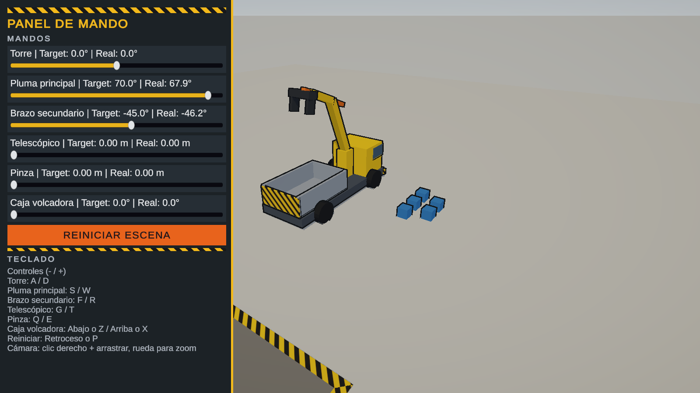

# Estilo visual "industrial toon"

Rama `feature/estilo-industrial`. Alcance "ligero": camión, entorno mínimo e interfaz. Solo cambia
cómo se ve la escena; la física (colliders, masas, drives, articulaciones, materiales físicos y
`TruckSpec`) no se tocó.

## Dirección visual

- Sombreado plano en 4 bandas de luz (cel shading) y una línea de contorno oscura en todas las
  piezas de la máquina y las cargas.
- Grúa en amarillo de seguridad con el tramo telescópico en naranja, sobre chasis gris acero
  oscuro y caja gris acero claro. Cabina amarilla con banda de vidrio.
- Acentos con franjas de peligro (amarillo y negro): compuerta trasera, paragolpes delantero y
  marco del corralón de descarga.
- Cielo en degradado simple y suelo de hormigón claro sin contorno, para que el camión destaque.
- Panel de interfaz de acero oscuro opaco, borde derecho amarillo, franja de peligro arriba y
  como separador, título "PANEL DE MANDO" y secciones "MANDOS" / "TECLADO" en mayúsculas.
  El botón es naranja con el texto en negrita y mayúsculas (estilo `UpperCase` de TMP: el texto
  guardado sigue siendo `Reiniciar Escena`).

## Paleta

| Uso | Hex |
|---|---|
| Amarillo de seguridad (grúa, cabina, acentos UI) | `#F2B91B` |
| Naranja de seguridad (telescópico, botón) | `#E8641E` |
| Chasis (acero oscuro) | `#3B424B` |
| Caja (acero claro) | `#8C949E` |
| Pinza (grafito) | `#2A2D31` |
| Ruedas | `#1B1C1E` |
| Vidrio | `#3E5566` |
| Negro de franjas | `#17181A` |
| Cargas (azul) | `#2E6FB4` |
| Contorno | `#121417` |
| Sombra (banda más oscura) | `#A3ACBD` |
| Suelo | `#C4C2BB` |
| Corralón | `#6F6C66` |
| Cielo cenit / horizonte | `#6F9CC4` / `#DCE4E8` |
| Sol | `#FFFAF2` |
| Panel / fila / pista del slider | `#1C2127` / `#272D35` / `#0E1114` |
| Texto / texto secundario / tirador | `#EEF1F4` / `#B4BCC6` / `#E9ECEF` |

## Cómo funciona el shader

`Assets/Shaders/IndustrialToon.shader` (`Truck/IndustrialToon`), HLSL para URP, sin texturas:

- **UniversalForward**: `N·L` de la luz principal por la atenuación de sombra, cuantizado en
  `_Bands` (4) niveles; el resultado mezcla entre `_ShadeColor` y el color de la luz. Las franjas
  de peligro son procedurales: una coordenada diagonal en metros del objeto (posición local por la
  escala del objeto) y `fwidth` para suavizar el borde; `_StripeMix` las activa sin variantes
  extra. Solo compila `_MAIN_LIGHT_SHADOWS` y `_MAIN_LIGHT_SHADOWS_CASCADE` (6 variantes).
- **Outline** (`LightMode = SRPDefaultUnlit`, `Cull Front`): casco invertido. Cada vértice se
  desplaza en la dirección `clamp(2·posiciónLocal, -1, 1)` llevada a mundo solo con la rotación;
  así un cubo o un cilindro primitivo de Unity se inflan lo mismo en todas las caras (sin huecos en
  las esquinas aunque la caja esté muy estirada). El ancho se pide en píxeles (`_OutlinePixels`,
  2) y se limita a `_OutlineMaxWidth` (6 cm) para no tapar piezas finas. Se apaga por material con
  `Material.SetShaderPassEnabled("SRPDefaultUnlit", false)` (suelo y corralón).
- **ShadowCaster**, **DepthOnly** y **DepthNormals** propios para proyectar sombras y convivir con
  el SSAO del renderer de PC.

Elegí shader propio con casco invertido en vez de un Renderer Feature "Render Objects" porque
queda dentro de cada material (sin tocar los assets de renderer de PC y Mobile) y cuesta una pasada
extra de vértices simple por objeto, sin pases de pantalla completa.

`Assets/Shaders/GradientSky.shader` (`Truck/GradientSky`) es un skybox de una pasada: degradado
horizonte-cenit y color liso bajo el horizonte (igual al suelo, para disimular el borde del
plano de 80 m).

## Dónde viven las constantes

- `Assets/Scripts/Editor/TruckPalette.cs`: todos los colores (escena e interfaz).
- `Assets/Scripts/Editor/TruckMaterials.cs`: un material por rol (grúa, chasis, peligro, suelo...).
- `Assets/Scripts/Editor/TruckAssetStore.cs`: crea o actualiza los `.mat` en `Assets/Materials`
  (`Mat_Toon_*`, `Mat_Cielo`), la textura de franjas de la UI generada por código
  (`Assets/Textures/Tex_FranjasPeligro.asset`) y los parámetros del toon (bandas, ancho de
  contorno, franjas por metro).
- `Assets/Scripts/Editor/TruckSceneStyle.cs`: skybox, luz ambiente plana y color/intensidad/sombra
  dura del sol. Se llama desde `TruckBuilder.Build`.
- `Assets/Scripts/Editor/TruckUiFactory.cs`: tamaños y estructura del panel.
- `TruckBodyFactory` agrega dos acentos solo visuales sin collider: `Visual_Ventanas` y
  `Visual_Paragolpes`; `TruckLoadsFactory` agrega `Visual_BordeCorralon` (4 tiras, sin collider).

Todo sale del generador: `Tools > Truck > Build And Save Main Scene` reconstruye la escena con el
estilo. Se borraron los antiguos `Mat_Visual_*.mat` (URP Lit), que ya no usa nadie.

## Verificado

- Los dos shaders compilan para GLES3 (WebGL 2) en todas sus variantes con
  `ShaderData.Pass.CompileVariant(..., ShaderCompilerPlatform.GLES3x, BuildTarget.WebGL)`, sin
  errores ni avisos. Consola del Editor sin errores ni warnings al terminar.
- Escena regenerada y guardada. Comparando con `main`: masas, tamaños y centros de colliders,
  drives (stiffness, damping, force limit, límites), anclas y materiales físicos de la escena son
  idénticos; los cuerpos con `ArticulationBody` siguen con escala 1 y sin malla.
- Play mode: arranca en pose plegada (Pluma 67.9°, Secundario -46.2°, resto en 0); el eje Torre
  sigue un target nuevo (45° → Real 45.0°; -76.6° → -76.5°). Agarre de un cubo sobre la caja y
  volcado a 55° con las cargas deslizando al corralón.
- Revisado desde la cámara por defecto y desde otros ángulos orbitales, con la grúa plegada y con
  la pinza sosteniendo un cubo. La UI se lee a 1600x900 y sigue legible (pequeña) a 695x391.
- No se cambió ningún test: ninguno fija nombres ni colores de materiales visuales. Se mantienen
  el formato de telemetría, los 6 sliders (navegación None), un botón, un EventSystem y la leyenda.

Capturas (Game view con la UI): `img/estilo_01_general.png`, `img/estilo_02_panel.png` (recorte
del panel), `img/estilo_03_agarre.png`, `img/estilo_04_volcado.png`.

## Notas WebGL y rendimiento

- Sin geometry/compute shaders, sin post-proceso ni pases de profundidad/normales extra en Mobile
  (el renderer de WebGL no tiene features). Coste: una pasada de contorno por objeto de la máquina
  (unos 40 objetos de 12-24 vértices) y un skybox de una pasada.
- Shaders y materiales compatibles con SRP Batcher (todas las propiedades en `UnityPerMaterial`).
- Sombras duras: el toon ya cuantiza, así que no compila las variantes de sombra suave.
- Verificado en la auditoría (`docs/AUDITORIA.md`): tests en verde y las líneas "not supported on
  this GPU" de la build.

## No verificado / limitaciones

- Los tests y el build WebGL se corrieron después, en la auditoría: ver `docs/AUDITORIA.md`.
- El ancho del contorno depende de `UNITY_MATRIX_P._m11`; está con `abs()` por el volteo de Y al
  renderizar a textura. Verificado en Editor (D3D11); en WebGL debería ser igual, pero no lo vi.
- La Game view quedó con resolución fija 695x391 (la usé para capturar); volver a "Free Aspect"
  desde el menú de la Game view si se prefiere.
